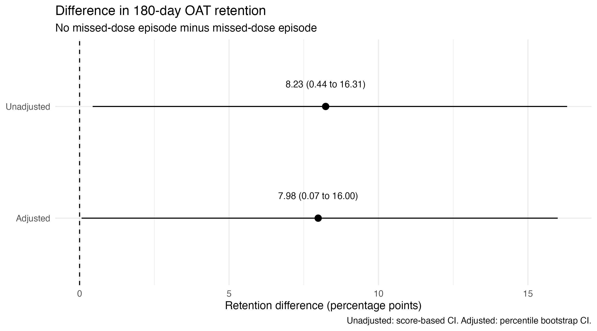

---
title: "OAT Retention: Real-World Evidence Analysis"
subtitle: "Synthetic cohort — 180-day retention"
format:
  html:
    toc: true
    code-fold: true
execute:
  echo: false
  warning: false
  message: false
---

```{r}
#| label: setup
#| include: false

project_dir <- path.expand(
  "~/Documents/R_Projects/OAT_Retention_RWE"
)

oat_data <- read.csv(
  file.path(
    project_dir,
    "data",
    "synthetic_oat_cohort.csv"
  )
)

results <- read.csv(
  file.path(
    project_dir,
    "oat_retention_results.csv"
  )
)
```

```{r}
# Setup: load the synthetic dataset and results


project_dir <- path.expand(
  "~/Documents/R_Projects/OAT_Retention_RWE"
)

oat_data <- read.csv(
  file.path(project_dir, "data", "synthetic_oat_cohort.csv")
)

results <- read.csv(
  file.path(project_dir, "oat_retention_results.csv")
)

adjusted_retention <- read.csv(
  file.path(
    project_dir,
    "oat_retention_adjusted_retention.csv"
  )
)

```

## 1. Study objective

This project examines the association between a missed-dose
episode and 180-day retention among a synthetic cohort
receiving opioid agonist treatment (OAT).

## 2. Study population

The current synthetic dataset contains 500 participants.
The exposure is a recorded missed-dose episode, and the
outcome is retention at 180 days.

## 3. Methods

### Study design and data source

This project uses a simulated observational cohort of 500 participants receiving opioid agonist treatment (OAT). The dataset was generated for analytical training and demonstration purposes; it does not contain actual patient-level study observations.

### Exposure and outcome

The exposure was a recorded missed-dose episode, represented as a binary variable. The outcome was retention in treatment at 180 days, also represented as a binary variable.

### Descriptive and unadjusted analysis

Retention proportions were calculated separately for participants with and without a recorded missed-dose episode. The unadjusted difference in retention proportions was expressed in percentage points, calculated as retention among participants without a missed-dose episode minus retention among participants with an episode. A 95% confidence interval was calculated using the score-based method implemented in `DescTools`.

### Adjusted analysis

A multivariable logistic regression model was fitted with 180-day retention as the outcome and missed-dose episode as the main exposure. The model adjusted for age, housing stability, mental health condition, and prior OAT.

Adjusted retention estimates were obtained by standardisation: each participant's covariates were retained while the missed-dose exposure was set first to absent and then to present. Predicted probabilities were averaged within each scenario. The adjusted retention difference was calculated as the difference between these two average predicted probabilities, expressed in percentage points.

### Bootstrap uncertainty estimation

A non-parametric percentile bootstrap was used to estimate the 95% confidence interval for the adjusted retention difference. Participants were resampled with replacement, the logistic regression model was refitted, and the standardised retention difference was recalculated for each successful replicate. The confidence limits were taken from the 2.5th and 97.5th percentiles of the successful bootstrap estimates.

### Statistical interpretation

Results are presented as retention differences in percentage points, with 95% confidence intervals. Because the data are synthetic and the analysis is observational in structure, findings demonstrate an analytical workflow rather than clinical evidence or a causal effect.


## 4. Unadjusted findings

```{r}
unadjusted <- results[
  results$analysis == "Unadjusted",
]

# Calculate retention percentages directly from the dataset
unadjusted_data <- oat_data[
  complete.cases(
    oat_data[, c("missed_dose_episode", "retained_180d")]
  ),
]

retention_by_group <- with(
  unadjusted_data,
  tapply(
    retained_180d,
    missed_dose_episode,
    mean
  )
) * 100

cat(sprintf(
  "No missed-dose episode: %.2f%% (%d/%d participants)\n\n",
  retention_by_group["FALSE"],
  sum(unadjusted_data$missed_dose_episode == FALSE &
      unadjusted_data$retained_180d == 1),
  sum(unadjusted_data$missed_dose_episode == FALSE)
))

cat(sprintf(
  "Missed-dose episode: %.2f%% (%d/%d participants)\n\n",
  retention_by_group["TRUE"],
  sum(unadjusted_data$missed_dose_episode == TRUE &
      unadjusted_data$retained_180d == 1),
  sum(unadjusted_data$missed_dose_episode == TRUE)
))

cat(sprintf(
  "Retention difference: %.2f percentage points\n\n",
  unadjusted$estimate
))

cat(sprintf(
  "95%% confidence interval: %.2f to %.2f percentage points.",
  unadjusted$lower,
  unadjusted$upper
))
```


## 5. Adjusted findings

The adjusted logistic regression model accounts for
age, housing stability, mental health condition,
and prior OAT.


```{r}
adjusted <- results[
  results$analysis == "Adjusted",
]

ret_no_episode <- adjusted_retention$retention_percent[
  adjusted_retention$scenario == "No missed-dose episode"
]

ret_episode <- adjusted_retention$retention_percent[
  adjusted_retention$scenario == "Missed-dose episode"
]

cat(sprintf(
  "Standardised predicted retention, no missed-dose episode: %.2f%%\n",
  ret_no_episode
))

cat(sprintf(
  "Standardised predicted retention, missed-dose episode: %.2f%%\n",
  ret_episode
))

cat(sprintf(
  "Adjusted retention difference: %.2f percentage points\n",
  adjusted$estimate
))

cat(sprintf(
  "Bootstrap 95%% CI: %.2f to %.2f percentage points.\n",
  adjusted$lower,
  adjusted$upper
))
```


## 6. Visualisation

```{r}

```


## 7. Interpretation

In this synthetic cohort, 180-day retention was 78.66% among participants without a missed-dose episode and 70.43% among participants with an episode. The unadjusted retention difference was 8.23 percentage points (95% CI: 0.44 to 16.31).

After adjustment for age, housing stability, mental health condition and prior OAT experience, the estimated retention difference was 7.98 percentage points (95% percentile bootstrap CI: 0.07 to 16.00).

The similarity between the unadjusted and adjusted estimates suggests that adjustment for the selected characteristics made little difference to the estimated association. However, the adjusted confidence interval approaches zero, indicating uncertainty around the magnitude of the difference.

These findings demonstrate an analytical workflow using simulated data. They are not clinical evidence and do not establish a causal relationship. Application to real-world data would require assessment of data quality, missingness, residual confounding, model assumptions and the definition of a missed-dose episode.

## 8. Reproducibility

```{r}
sessionInfo()
```

